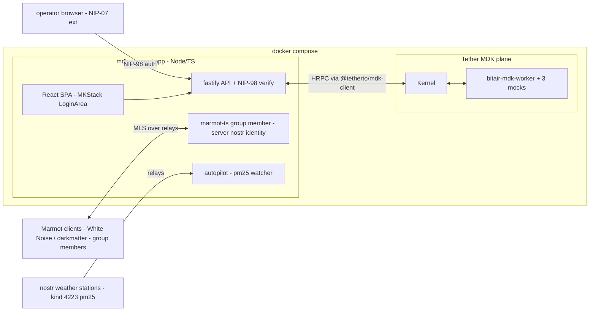

# mdk² (mdk-squared) — Heatbit BitAir fleet control, built on two MDKs

**Two MDKs, one app:**
- **Tether MDK** (Mining Development Kit) — the device plane: BitAir Worker, Kernel, telemetry + commands
- **Marmot MDK** (Marmot Development Kit) — the people plane: **embedded via `@internet-privacy/marmot-ts`**
  (first-party TS implementation, alpha — pin version); MLS E2EE groups (RFC 9420) with Nostr identity.
  **The app itself is a group member**: chat is the control plane, group state is the access list.

One command (`docker compose up`) brings up: three BitAir devices (mocked, real later) behind a
Tether-MDK Worker, a React app you sign into **with your Nostr identity** (NIP-07 + NIP-98, login
component lifted from MKStack), authorization **read from the live Marmot group state**, control
**by messaging the app inside the E2EE group** from any Marmot client, and an autopilot that
switches the air purifiers on/off from **live PM2.5 readings published to Nostr by your weather
stations** (kind 4223, draft NIP PR 2163).

## Verified facts (researched 2026-11-05)

- **No Heatbit Worker exists** in Tether MDK: 0 hits in issues, catalogue, `external-workers.json`.
  Heatbit Inc. is in the 15-company commitment roster; nothing shipped. We build one.
- **BitAir firmware is ESP-Miner-derived** (ESP32-S3, local browser dashboard per reporting on the
  Bitwater sibling) → AxeOS-style local HTTP API is the right model for the Worker client. Exact
  endpoints undocumented until Heatbit ships; mock-first means nothing blocks.
- **`marmot-ts` exists and is first-party** (`marmot-protocol/marmot-ts`, npm `@internet-privacy/marmot-ts`):
  TS, Node 20+, MLS via bundled `ts-mls` fork, supports MIP-00..03 incl. **Group State & Memberships**,
  storage/network-agnostic (server-side file/SQLite store + nostr-tools). **Alpha, breaking changes** — pin.
  Wire-compatible with the `darkmatter` reference client (Marmot v2). Interop with White Noise
  (Rust MDK) **unverified** → P5a spike.
- **Rust fallback exists**: `marmot-protocol/mdk` (`wn` CLI, `wnd` daemon, `wn-agent` connector) if
  marmot-ts ↔ White Noise interop fails.
- **MKStack** (`gitlab.com/soapbox-pub/mkstack`): React 18 + Vite + Tailwind + shadcn/ui + Nostrify,
  **public-domain licensed**, ships `LoginArea` + `useCurrentUser`/`useNostr` hooks (NIP-07,
  multi-account) — login out of the box by copying it in.
- **Weather events exist today**: samthomson/weather-station publishes kind 16158 (station
  metadata) + kind 4223 (readings: `["pm25","12","PMS5003"]` tags). Draft NIP PR 2163 (unnumbered).
- **Tether MDK supports app-without-Gateway**: dispatch commands / pull telemetry with just
  `@tetherto/mdk-client` — so Nostr+Marmot auth **replaces** MDK's Gateway auth, no double login.

## Architecture

**Authz model:** HTTP layer = NIP-98 (any Nostr key can *authenticate*); *authorization* = "is this
npub in the Marmot group?" — read from the app's own live group state (it is a member). `ADMIN_NPUB`
env var bootstraps the owner before the group invite completes. Admin adds operators by inviting
them to the group from their Marmot client — **the group IS the access list**.

**Control channels (both first-class):**
1. **Chat**: `!air on|off|eco|high [device]`, `!air status`, `!air autopilot on 35 25` — any member,
   E2EE, replied in-group. 
2. **Web**: NIP-98 login → dashboard (telemetry, schedules, autopilot config, manual toggles).

## Decisions

| Topic | Decision | Why |
|---|---|---|
| Language | App: Node 24 + TypeScript. Worker handlers: CJS JS (WorkerRuntimeV2 requires `require()`) | MDK constraint |
| Tether-MDK shape | Kernel + Worker + standalone app via `@tetherto/mdk-client`; no Gateway | NIP-98 is the auth layer; no double login |
| Marmot integration | **`marmot-ts` embedded in the app**; server-owned nostr identity; SQLite/file-backed stores; nostr-tools network | Pure TS, no sidecar; fallback = Rust `wnd`/`wn-agent` sidecar |
| UI + login | Scaffold from **MKStack**; reuse `LoginArea`, `useCurrentUser`, `useNostr` as-is (public domain) | Works out of the box |
| HTTP auth | NIP-98 (kind 27235) signed by NIP-07; server verifies signature + freshness | Standard, no passwords, no nsec server-side |
| Chat commands | Tiny `!air` grammar, parsed from decrypted application messages; every action logged + echoed in-group | Zero-friction control from phone |
| Autopilot | Subscribe kind 4223 from selected station pubkeys (picked via kind 16158); PM2.5 > ON → purify ON; < OFF → OFF (hysteresis ~35/25 µg/m³, configurable); manual override wins | Own data format — dogfooding PR 2163 |
| Device model | Contract: `power_mode` (off/eco/low/high), `mining_enabled`, `fan_speed`; schedule executor app-side | Matches AxeOS-style APIs; minimal contract |
| Real devices later | `mock: false` + LAN IPs; zero app changes | MDK mock design |

## Phases

### P0 — Scaffold (½ day)
- Repo `mdk-squared/`: `app/` (TS, fastify), `ui/` (MKStack scaffold or vendored), `worker/` (bitair-mdk-worker), `compose.yaml`, `.env.example` (`ADMIN_NPUB`, `RELAYS`, thresholds).
- **Accept**: `docker compose up` boots skeleton; UI served; health route answers.

### P1 — bitair-mdk-worker (1 day) ← standalone-value artifact
- `mdk-contract.json`: telemetry `hashrate_ghs`, `power_w`, `fan_rpm`, `pm25_ugm3`, `filter_life_pct`, `temp_c`; health OK/DEGRADED/OFFLINE.
- Commands: `setPowerMode(mode)`, `setFanSpeed(pct)`, `setMining(bool)`, `reboot()`.
- `src/client.js`: AxeOS-style HTTP client; adjust to real endpoints when Heatbit documents them.
- `mock/server.js`: 3 mock BitAirs, drifting telemetry, command effects, `/mock/fault` injector.
- **Accept**: `mdk validate worker --path worker --smoke` passes.

### P2 — Tether-MDK plane in compose (½ day)
- Services `kernel` (local key-dir discovery, shared volume) + `worker` (mocks on); app connects via `@tetherto/mdk-client`.
- **Accept**: from app container — list devices, pull telemetry, `setPowerMode` visibly changes mock state.

### P3 — App core + NIP-98 auth + MKStack login (1 day)
- Fastify TS: `/authchallenge` + `/auth` (NIP-98 verify), middleware on `/api/*`; session tokens; `ADMIN_NPUB` bootstrap allowlist (temporary until group authz lands in P5).
- UI: MKStack `LoginArea` wired to challenge/verify; device routes `GET /api/devices`, `POST /api/devices/:id/{power,fan,mining}`, `GET/PUT .../schedule` (app-side cron executor).
- **Accept**: browser sign-in with NIP-07 → device cards → toggle → mock state changes; unsigned/foreign key → 401.

### P4 — Device + schedule UI (1 day)
- Cards with live telemetry (poll/SSE), power/fan/mining controls, schedule editor, status log.
- **Accept**: full control loop from browser against 3 mocks.

### P5 — Marmot integration (1–2 days, spike first) ← the second M in mdk²
- **P5a — interop spike (1h, gating)**: two test identities — marmot-ts (script) and your Marmot client
  (White Noise; darkmatter if needed). Create group, invite across, send message both ways. 
  - Works → proceed in TS. 
  - Fails → pivot to Rust `wnd`/`wn-agent` sidecar container (fallback documented above); nothing else in the plan changes.
- Server nostr identity (persisted secret), `keyPackages.create()`, admin invites the app into the
  group from their client; `joinGroupFromWelcome`; subscribe kind 445 for the group; SQLite-backed stores.
- Authz: middleware checks npub against current group members from live group state.
- Chat commands: `!air` grammar → Tether-MDK commands → reply in-group; action log.
- **Accept**: invite a second npub from the Marmot client → they sign into the web app with no
  restart; `!air on high` in-chat toggles a mock and gets a status reply; remove from group → access revoked at next state refresh.

### P6 — Autopilot (1 day)
- nostr-tools SimplePool: station picker (kind 16158 with `pm25` sensor tag), per-station enable; threshold + hysteresis config; override toggle; MDK actuation; trigger log.
- `tools/seed-weather.mjs` replays synthetic pm25 spikes for demos.
- **Accept**: seeded pm25 40 → purifiers ON; 15 → OFF; override respected; no flapping.

### P7 — Demo polish (½ day)
- README (diagram, 2-min demo script), compose `demo` profile, `.env` docs.
- **Accept**: fresh `docker compose up --profile demo` → working site < 2 min.

## Risks / open questions

1. **marmot-ts ↔ White Noise interop** (P5a, 1h spike): marmot-ts targets Marmot v2 / darkmatter
   wire format; White Noise runs on Rust MDK. If incompatible → Rust sidecar fallback (bounded,
   documented) or members use a v2 client.
2. **marmot-ts is alpha** — pin exact version; wrap group operations behind one module so API churn stays local.
3. **BitAir real API unknown** — mock-first; `client.js` rewritten when Heatbit ships docs.
4. **kind 4223 is our own draft NIP** — pin parsing to weather-station's tag format; tolerate drift with loose parsing + logged skips.
5. **MKStack scaffold brings opinions** — vendor only `LoginArea`, hooks, shadcn bits if the full scaffold fights our fastify backend.

## Out of scope (v1)

- Real BitAir hardware bring-up (P8 when docs exist)
- Native MLS in TS beyond marmot-ts (no crypto of our own, ever)
- Payments, multi-site federation

---

## Build log (2026-11-05) — all phases complete, verified

- **P1** `worker/`: 5/5 tests — strict contract validation, telemetry, commands,
  ERR_ passthrough, offline detection.
- **P2/P3** app boots kernel+worker+mocks+client in one process (private loopback
  DHT; simplification from the 3-service sketch — same seams, fewer moving parts).
  NIP-98 login, RBAC via kernel service account, trusted-keys admission for the
  client. Smoke: login/devices/commands/authz all green.
- **P4** React SPA (vite), NIP-07+NIP-98 login mirroring MKStack's LoginArea
  pattern; browser-verified end-to-end (click → command → telemetry/log update).
- **P5** marmot two-client self-test green: key packages → invite → join → E2EE
  `!air on high` round trip on live relays. White Noise interop = invite by hand
  (README). Notable fixes: v8 structured-clone stores (JSON corrupts MLS state),
  per-filter querySync (marmot passes filter arrays), UnreadInvite *is* the welcome.
- **P6** autopilot e2e green: nostr pm25 45 → fleet HIGH, 12 → eco, with
  hysteresis + manual override. Relay kind-policies discovered: primal.net accepts
  16158/4223; relaying.earth blocks them.
- **P7** Dockerfile + compose (single service + volume), container smoke green
  (login/devices/commands/authz in-container).

Open (by design): BitAir real endpoints when Heatbit ships docs; White Noise ↔
marmot-ts invite round-trip needs a human with the app.
